# svg_charts

[](https://pub.dev/packages/svg_charts)
[](https://dart.dev/null-safety)
[](https://github.com/gmpassos/svg_charts/actions/workflows/dart.yml)
[](https://codecov.io/gh/gmpassos/svg_charts)
[](https://github.com/gmpassos/svg_charts/releases)
[](https://github.com/gmpassos/svg_charts/network)
[](https://github.com/gmpassos/svg_charts/commits/main)
[](https://github.com/gmpassos/svg_charts/pulls)
[](https://github.com/gmpassos/svg_charts)
[](https://github.com/gmpassos/svg_charts/blob/main/LICENSE)

Charts rendered as SVG markup: columns, bars, lines, areas, sparklines,
scatter plots, pies and donuts, meters, gauges, heatmaps and stat tiles.

Pure Dart: a chart is a value whose `render()` returns an `<svg>` string. No
DOM, no `dart:io`, so the same chart renders in a browser, on a server (an
HTML report, an e-mail, a `.svg` file) or in an isolate. Every mark has a hover
hint, light and dark themes come built in, and a small companion library adds a
styled tooltip and clickable marks in the browser.

```dart
import 'package:svg_charts/svg_charts.dart';

void main() {
  final svg = ColumnChart.of(
    [42, 51, 38, 64, 72, 69, 80, 77, 61, 58, 66, 90],
    name: 'orders',
    labels: ['Jan', 'Feb', 'Mar', 'Apr', 'May', 'Jun',
             'Jul', 'Aug', 'Sep', 'Oct', 'Nov', 'Dec'],
    title: 'Orders per month',
    shares: true,
  ).render();
  print(svg);
}
```


Hovering the April column shows `Apr · orders: 64 · 8% of the total`.

## What's in it

| | |
| --- | --- |
| **Columns** | `ColumnChart` (single, grouped, stacked, negatives), `Histogram` |
| **Bars** | `BarChart` (ranked, grouped, stacked, labelled directly) |
| **Lines** | `LineChart` (multi-series, gaps, `smooth:`), `AreaChart` |
| **Inline** | `Sparkline`, `StatTile` |
| **Points** | `ScatterChart` |
| **Parts of a whole** | `PieChart` (and `donut:`, with an "Other" slice past `maxSlices`) |
| **One value** | `Meter`, `Gauge` |
| **Grids** | `Heatmap` |
| **Browser** | `installChartHints`, `insertChart` (`package:svg_charts/svg_charts_web.dart`) |
| **Building blocks** | `SvgChartTheme`, `SvgPalette`, `svgChartsCss`, `niceTicks`, `LinearScale`, `markHint`, `formatNumber`, `formatCompact`, `formatRate`, `SvgWriter` |

Run `dart run example/gallery.dart` to write every chart to `doc/images/` and
`doc/gallery.html` (light and dark).

## Things to know

### Charts are strings

`render()` (or `toString()`) returns one `<svg>` element. Put it in a page with
`innerHTML`, write it to a file, embed it in an HTML e-mail or a server-rendered
report. Nothing is measured against a live DOM: text widths are estimated, so a
chart renders the same everywhere, and **the same bytes on the VM and on the
web** (the test suite checks this in Chrome).

### Sizes are explicit, or responsive

Every chart takes a `width` and `height` in px (its view box). With
`responsive: true` it takes its container's width and keeps its aspect ratio.

### Every mark has a hint

A column, bar, point, slice or cell carries its hint three ways:

- a native `<title>`: a tooltip in any browser, even in a standalone `.svg`;
- a `data-hint` attribute: what the web companion's styled tooltip shows;
- an accessible name (`role="img"`, `aria-label`) for screen readers.

A hint says what the mark is, its series and value, and with `shares: true` its
share of the whole: `delivered · orders: 4,210 · 47% of the total`. Shares are for
values that add up (counts, sums). They are never shown where a negative value
makes the whole meaningless. A `hint:` callback writes your own.

Line charts have a band per x position the plot's full height. Its hint lists
every series there, and it shows a crosshair, so the pointer needn't aim at a
2 px line.

### A gap is not a zero

`null`, `NaN` and infinities are **missing data**: no column, a break in the
line, an empty heatmap cell, never a mark at zero. A fabricated zero is usually
the most alarming point on a chart. In a **stacked** chart a missing value adds
nothing, as a stack is a composition.

```dart
LineChart.of([5, 6, null, 7, 6]);  // two runs, not a dive to zero
```

## Columns, stacked and grouped

```dart
ColumnChart(
  [
    Series([120, 132, 101, 134, 90, 230, 210], name: 'delivered'),
    Series([22, 18, 19, 23, 29, 33, 31], name: 'canceled'),
  ],
  labels: ['Mon', 'Tue', 'Wed', 'Thu', 'Fri', 'Sat', 'Sun'],
  mode: BarMode.stacked,
  shares: true,
);
```


Negative values hang below the baseline, in the palette's negative colour
(several series keep their own colours, as colour names the series):


`Histogram(values, bins: 16)` counts values into equal-width bins, each hint
giving its range, count and share:


## Bars

Horizontal bars, labelled directly, with no value axis. They suit ranked
categories with long names. `sorted: true` ranks them, and `mutedLabels` dims a
"no value" or "others" row:

```dart
BarChart.of(
  [4210, 3120, 960, 480, 120],
  name: 'orders',
  labels: ['delivered', 'paid', 'canceled', 'refunded', '(no value)'],
  mutedLabels: {4},
  sorted: true,
  shares: true,
);
```


## Lines and areas

```dart
LineChart(
  [Series(visits, name: 'visits'), Series(signups, name: 'signups')],
  labels: days,
  smooth: true,
);
```


`smooth: true` draws a monotone curve (Fritsch–Carlson), which never overshoots
its points. A natural spline would invent peaks and dips the data doesn't have.
A line's axis fits its data. An area's includes zero, as its filled area is a
magnitude.

## Scatter, pie and donut


```dart
PieChart.of([62, 25, 13], labels: ['web', 'app', 'api']);
PieChart.of(statusCounts, labels: statuses, donut: true, maxSlices: 6);
```


Past `maxSlices`, the smallest slices fold into one "Other" slice: more than
about eight colours can't be told apart, and slivers can't be compared anyway.

## Heatmap, gauge, meter, sparkline, stat tile


The heatmap's ramp is in steps, so each colour is a range you can read off its
legend. An empty cell is drawn as empty, never as the lowest step.



```dart
Gauge(72, label: 'CPU %');
Meter(0.42, title: 'Disk used');           // "<1%" for 0.004, never "0%"
Sparkline([4, 6, 5, 9, 7, 11], title: 'Signups');
StatTile.number(label: 'Orders today', value: 5894,
    delta: '+12% vs. yesterday', trend: Trend.good,
    trendValues: [40, 42, 39, 47, 52, 50, 58]);
```

A stat tile's change carries its ▲ or ▼, so colour is never the only cue.

## Themes and colours

The default palette is a validated data-visualisation palette:

- eight categorical hues, ordered so adjacent series stay distinct under the
  common colour-vision deficiencies;
- each hue stepped separately for the light and the dark surface (not an
  automatic inversion);
- a one-hue sequential ramp for heatmaps;
- recessive grid, axis and ticks.

Each chart embeds a small style sheet. Its rules read **CSS custom properties**,
with the theme's colours as fallbacks:

- **A standalone `.svg` file** looks right on its own.
- **A page restyles every chart** by setting properties on any ancestor:
  `--svgc-series-1`, `--svgc-text`, `--svgc-grid`, `--svgc-surface`, and so on.
- **Dark mode** (`SvgChartTheme.auto`, the default) follows
  `prefers-color-scheme`, or a `data-theme="dark"` / `"light"` attribute on the
  root element, which wins both ways.
- **`SvgChartTheme.light`** and **`SvgChartTheme.dark`** fix one scheme.
- **`embedStyle: false`** writes classes only. Include `svgChartsCss(theme)` once
  in the page instead.
- **Marks carry their colour as a presentation attribute**, so renderers without
  CSS still draw them.

```css
.my-dashboard { --svgc-series-1: #7c3aed; --svgc-text: #111; }
```

An inline SVG's `<style>` applies to the whole page. Two different themes on one
page therefore need different class prefixes:
`SvgChartTheme.dark.copyWith(prefix: 'svgcd')`.

## In the browser

```dart
import 'package:svg_charts/svg_charts.dart';
import 'package:svg_charts/svg_charts_web.dart';
import 'package:web/web.dart' as web;

void main() {
  installChartHints(); // once per page: harmless to call again
  insertChart(
    web.document.querySelector('#orders')!,
    ColumnChart.of([12, 30, 18], labels: ['Jan', 'Feb', 'Mar']),
    onMark: (index, series) => print('clicked category $index'),
  );
}
```

`installChartHints` shows each mark's hint in one styled tooltip:

- it follows the mouse, and appears on a tap on touch screens;
- it hides on scroll, when the pointer leaves the window, and when a click
  removes the mark (a drill-down);
- it stays inside the window;
- it replaces the native `<title>` tooltip, so only one shows.

`insertChart` puts a chart in an element, and with `onMark` makes its marks
clickable. The click gives the mark's category index and series.

See `example/web/` for a page with every chart.

## Notes on correctness

Ways an SVG chart goes wrong, each handled here with a test:

- **One output on every platform.** A double interpolated into a string is
  `12.0` on the VM and `12` under dart2js, and `1.0 is int` is true on the web
  only. Every number goes through one formatter, and the gallery's fingerprints
  are checked in Chrome.
- **No `NaN` or `Infinity` in the markup.** SVG parsers reject them, and one bad
  coordinate would blank the whole chart. Coordinates are written with at most
  2 decimals and never `-0`.
- **Labels are escaped.** A category named `<b>R&D</b>` is drawn as those
  characters, never as markup.
- **Axis ticks are round** (1, 2, 2.5, 5 × 10ⁿ) and never print
  `0.30000000000000004`.
- **The first and last x labels stay inside the plot**, and labels are cut with
  `…` before they are thinned, so one long label can't hide all the others.
- **Rates never round into a claim.** 0.004 is `<1%`, not `0%`; 0.996 is `>99%`,
  not `100%`.
- **Bars are rounded at their data end only**; the baseline end stays square.
  Stacked segments are 2 px apart.
- **The pointer's position is read as a fraction.** `package:web` types
  `clientX` as `int`, but a hi-DPI mouse gives `329.8`, and the dev compiler
  throws on that cast, so no hint would ever show.

Known limits:

- **Text widths are estimated** (no font metrics outside a browser). They are
  slightly generous, so labels err on fitting.
- **Labels are horizontal.** Crowded categories are thinned, never rotated.

## Running the example and tests

```sh
dart pub get
dart analyze
dart test                 # the VM suite
dart test -p chrome       # compiled to JavaScript, in a real browser
dart run example/svg_charts_example.dart
dart run example/gallery.dart
```

The browser suite is not ceremonial. It runs the web companion against real DOM
events, and it checks that every gallery chart renders to the same bytes as on
the VM. Two test files self-skip there (`@TestOn('vm')`: they read files from
disk), and the web companion's own tests run only there.

CI runs format, `analyze --fatal-infos --fatal-warnings`, `dependency_validator`,
`dart doc`, `pub publish --dry-run`, the VM suite with coverage, the browser
suite, and JavaScript compiles of both examples.

# Author

Graciliano M. Passos: [gmpassos@GitHub][github].

[github]: https://github.com/gmpassos

## License

[Apache License - Version 2.0][apache_license]

[apache_license]: https://www.apache.org/licenses/LICENSE-2.0.txt
